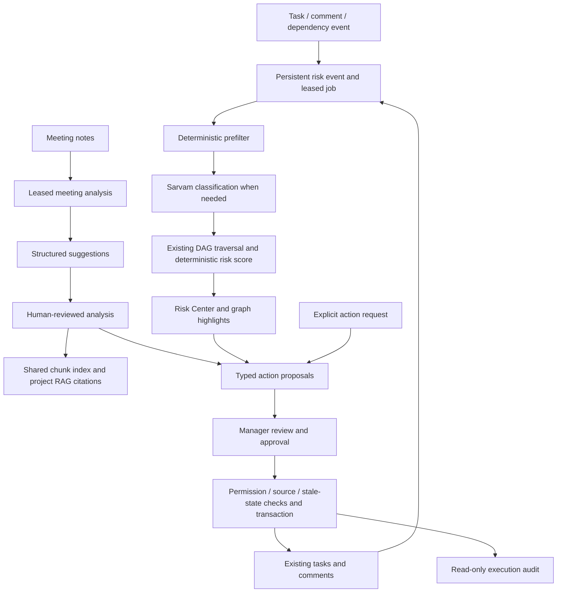

# TeamOS

TeamOS is a workspace for following projects, tasks, and team activity. Workspaces, projects, tasks, and comments are backed by Supabase PostgreSQL.

## Run locally

Use Node.js 24 and pnpm 11. From this directory, run:

```powershell
pnpm install --frozen-lockfile
if (!(Test-Path .env.local)) { Copy-Item .env.example .env.local }
```

1. Create a Supabase project. Copy its project URL and **publishable key** from the project's Connect dialog into `.env.local`. Use the publishable key for the web app. The optional Phase 7 document worker uses a separate server-only credential described below.
2. In Supabase **Authentication → Sign In / Providers**, enable Email sign-in, allow new users to sign up, and keep **Confirm email** enabled.
3. In **Authentication → URL Configuration**, set **Site URL** to `http://localhost:3000`. Use this same origin in `TEAMOS_SITE_URL` and in your browser. For production, use your HTTPS app origin.
4. In **Authentication → Email Templates → Confirm signup**, set the confirmation link to `{{ .SiteURL }}/auth/confirm?token_hash={{ .TokenHash }}&type=email`. This lets TeamOS verify the link and set the session on the server.
5. Set up custom SMTP if the hosted dashboard requires it to edit templates or if confirmation emails need to reach addresses outside your Supabase organization. For a quick login test, create an auto-confirmed test account in **Authentication → Users**.

```powershell
pnpm dev
```

Open [TeamOS on localhost](http://localhost:3000), sign up, and follow the confirmation link. The login and signup pages display a configuration message if the Supabase URL or publishable key is missing.

[Supabase Next.js authentication guide](https://supabase.com/docs/guides/getting-started/tutorials/with-nextjs) · [Supabase SMTP setup](https://supabase.com/docs/guides/auth/auth-smtp)

### Optional Google sign-in

1. In Google Cloud, create a **Web application** OAuth client. Configure its consent screen and add the Supabase provider callback from the Google provider settings as an **Authorized redirect URI**. For a hosted Supabase project it is normally `https://<project-ref>.supabase.co/auth/v1/callback`.
2. In Supabase **Authentication → Sign In / Providers → Google**, enable Google and enter the client ID and secret. Store the Google secret in Supabase.
3. Add `http://localhost:3000/auth/callback` to Supabase **Authentication → URL Configuration → Redirect URLs**. Add the exact HTTPS callback URL for each production deployment.
4. Set `TEAMOS_GOOGLE_AUTH_ENABLED=true` in `.env.local` and restart TeamOS. If the Google app is in testing mode, allow the Google accounts you will use as test users.

[Supabase Google OAuth setup](https://supabase.com/docs/guides/auth/social-sign-in/auth-google)

## Phase 3 database setup

1. In the Supabase project connected through `.env.local`, open **SQL Editor → New query**.
2. Run [the Phase 3 migration](supabase/migrations/20261118000000_workspaces_and_projects.sql) once. If you manage this project's migration history through the Supabase CLI, apply the file through your existing migration workflow instead.
3. Sign in to TeamOS and open **Workspaces** to create your first workspace. Use the workspace name in the header or the **Workspaces** sidebar item to return and switch teams.

| Role | Permissions |
| --- | --- |
| Owner | Manage projects, invite admins and members, revoke invitations, and change member/admin roles |
| Admin | Manage projects and invite or revoke invitations for members |
| Member | View workspace members and projects |

Invitations appear in **Workspaces → Your invitations** for the matching verified email address and expire after seven days. Share the TeamOS address with the recipient so they can sign in or create an account and accept. No invitation email is sent.

## Phase 4 task setup

After the Phase 3 migration, run [the Phase 4 migration](supabase/migrations/20261118010000_task_management.sql) once in the same Supabase SQL Editor. Then open **My Tasks** and choose **New task**. Assign it to a workspace member or leave it unassigned. Link it to a project if needed.

Workspace members can create tasks and comment. Owners, admins, and the task creator can edit or delete the task. The assignee can also move it through To Do, In Progress, Review, and Done. Drag the card by its handle or update the status in the task drawer. Use **Assigned to me** in the assignee filter for a personal view.

## Phase 5 dependencies

After Phase 4, run [the Phase 5 migration](supabase/migrations/20261118020000_task_dependencies.sql) once in Supabase SQL Editor.

Open **Dependencies**, choose a project, and add prerequisite → dependent links using node handles or the form. Owners, admins, and the dependent task's creator can add or remove its links. Both tasks must be assigned to that project. Tasks with existing dependencies must have their links removed before moving to another project.

Amber nodes identify unfinished tasks with unfinished immediate prerequisites. Select a node to open its task drawer. The **Prerequisite order** follows deterministic topological sorting. **Delay impact** traverses all downstream links, highlights those tasks, and lists them in prerequisite order, including completed descendants. It reports graph reachability without estimating schedule dates.

Deleting a task removes its edges. Deleting a project removes its edges and retains the existing unlinked tasks.

## Phase 6 AI project planner

1. Apply [the Phase 6 migration](supabase/migrations/20261118030000_ai_project_planner.sql) after the Phase 5 migration.
2. Create a Sarvam AI API key at [the Sarvam dashboard](https://dashboard.sarvam.ai/) and check your available API credits. Put the key in `.env.local` as `SARVAM_API_KEY`. Set `SARVAM_MODEL=sarvam-105b`, or choose another Sarvam Responses API model that supports structured outputs. OpenAI keys are not used. Restart TeamOS after changing environment variables.
3. As a workspace owner or admin, open **Projects → Generate with AI**. Enter a brief of 20–8,000 characters and optional team size, duration, deadline, technology stack, and instructions.
4. Generate a draft, review and edit task cards, change prerequisites, or add and remove tasks. Save edits with **Save draft** and return through **Saved plans** after a refresh. Regeneration creates a new draft.
5. Check the review checkbox, then choose **Approve & Create Tasks**. The import creates normal project tasks and dependency edges in one transaction. Repeating approval returns the existing import.

The default model is configurable. The implementation calls Sarvam at `https://api.sarvam.ai/v2` using its OpenAI-compatible interface, the existing OpenAI JavaScript SDK, `responses.parse`, `zodTextFormat`, and deterministic Phase 5 graph validation. Provider refusals, incomplete responses, invalid graphs, timeouts, and API failures produce error messages.

[Sarvam quickstart](https://docs.sarvam.ai/api/getting-started/quickstart) · [Sarvam Responses API](https://docs.sarvam.ai/api/token-factory/responses-api) · [Authentication](https://docs.sarvam.ai/api-reference/authentication)

### Drafts and imported tasks

Plans have generating, draft, approved, cancelled, or failed states. Requests are reserved before calling Sarvam, so saved requests remain visible if the browser leaves during generation. A generation that does not finish within two minutes can be cancelled and retried. The provider timeout is 75 seconds, automatic provider retries are disabled, and the planner page allows up to 120 seconds where the deployment supports that limit.

Each plan contains at most 30 tasks. Duplicate IDs, duplicate titles, missing prerequisites, repeated edges, self-links, and cycles fail validation. Removing a task clears its references and reports the affected tasks.

Approval checks current permissions and the draft revision, validates again in PostgreSQL, and atomically inserts tasks, dependency edges, and approval state. A failed insert rolls the entire import back. Existing tasks keep their values. Generated tasks start in To Do, are unassigned, and have no due date. Their descriptions include suggested roles, person-day effort estimates, and acceptance criteria. Planning deadlines guide the draft rather than assigning a schedule automatically.

Projects with tasks derive progress from their completed-task ratio. Projects without tasks retain manual progress entry; deleting the last task resets progress to zero.

### Planner security and usage

- Only workspace owners and admins can read, generate, edit, cancel, or approve plans. Every action verifies authentication and project access, and PostgreSQL enforces permissions independently.
- `SARVAM_API_KEY` is a server-only environment variable. Keep `.env.local` private and use the placeholder `.env.example` in source control.
- The project name, description, brief, and preferences are sent to Sarvam AI during generation. Review the submitted content before using confidential project information.
- Prompts treat project text as untrusted data. Model output is schema-checked and graph-validated before it becomes a draft. Approval creates only tasks and dependency edges.
- The Responses API request sets `store: false`. Sarvam's data handling policies apply to submitted content.
- A PostgreSQL reservation limits each user to one generation in progress for two minutes and three attempts per rolling ten minutes across projects. Failed and cancelled attempts count toward this limit.
- AI effort estimates require human review. API charges depend on the model and account usage.

### Planner tests

`pnpm test` uses Node.js 24's test runner and a disposable PGlite PostgreSQL instance. Provider calls are mocked, so tests spend no API credits. The integration test covers brief → structured draft → edited approval → persisted task rows and dependency IDs, plus isolation, role checks, stale edits, failed imports, rate limits, cancellation, and idempotent retries.

## Pages

| Route | Page |
| --- | --- |
| `/login` | Sign in with email and password or with Google if enabled |
| `/signup` | Create an account |
| `/` | Protected dashboard with workspace totals, recent projects, upcoming tasks, and activity |
| `/workspaces` | Create and switch workspaces, view members, and manage invitations |
| `/projects` | Projects in the active workspace with status, progress, and deadlines |
| `/projects/new`, `/projects/[projectId]/edit` | Create, update, or delete projects as an owner or admin |
| `/projects/[projectId]/plan` | AI planner, saved drafts, review, and approval |
| `/my-tasks` | Filterable Kanban board, task details drawer, and comments |
| `/dependencies?project=<id>` | Interactive project dependency graph and delay impact |

The header account menu shows the signed-in profile and provides sign-out. Project counts and recent projects come from the active workspace. Progress follows completed tasks when a project has tasks. Task totals and upcoming assignments come from the active workspace.

## Verification

```powershell
pnpm test
pnpm lint
pnpm typecheck
pnpm build
```

Run `pnpm start` to serve a completed production build.

After applying the migrations in a disposable Supabase PostgreSQL database, run the rollback-only tests for [workspace isolation](supabase/tests/workspace_isolation.sql) and [task permissions and persistence](supabase/tests/task_management.sql), and [dependency validation and access](supabase/tests/task_dependencies.sql).

## Source layout

- `src/app` contains public auth routes, protected workspace routes, and the theme.
- `src/components` contains the auth forms, application shell, page sections, and shared shadcn/ui primitives.
- `src/lib/auth`, `src/lib/supabase`, and `src/proxy.ts` handle server-side authentication and session refresh.
- `src/lib/workspaces` contains workspace and project queries, server actions, and Zod validation.
- `src/lib/tasks` contains task queries, server actions, validation, and permission rules.
- `src/lib/planner` contains the planner schema, provider service, persistence, and actions.
- `src/lib/dependencies` contains deterministic graph algorithms, queries, and server actions.
- `tests/graph.test.mjs` exercises graph algorithms and invalid links through Node.js 24.
- `supabase` contains database migrations and isolation tests.
- `src/types` contains workspace and authentication types.


## Phase 7: project documents and grounded assistant

All AI features use **Sarvam AI** through the existing OpenAI-compatible SDK pointed exclusively at Sarvam. No OpenAI API key or credits are needed. The default retrieval mode is PostgreSQL full-text search; indexing in this mode makes no AI calls. Answers and follow-up rewrites use `SARVAM_MODEL` (default `sarvam-105b`). Optional semantic retrieval uses Sarvam's `embeddinggemma-2`, which currently requires Provisioned Throughput enabled for your organisation. Full-text mode works with ordinary Sarvam chat access and does not depend on embedding provisioning.

### Activate Phase 7 in Supabase

1. Apply `supabase/migrations/20261118040000_project_knowledge.sql` once in the Supabase SQL Editor, after all existing migrations, then apply `supabase/migrations/20261118050000_sarvam_knowledge.sql`. If the first migration was already applied, run only the Sarvam migration. The upgrade preserves documents, files, and extracted text while clearing incompatible OpenAI vectors, changing the vector size to 768, and adding a full-text search index. The migration creates the `vector` extension in `extensions`, document/chunk tables, restricted RPCs, a private `project-documents` bucket, Storage policies, and persistent jobs. Do not make the bucket public.
2. Copy the new settings from `.env.example` into your ignored `.env.local`. Keep existing Supabase and Sarvam settings. Keep your existing `SARVAM_API_KEY` and `SARVAM_MODEL=sarvam-105b`. Set `RAG_RETRIEVAL_MODE=fulltext`. `SARVAM_EMBEDDING_MODEL=embeddinggemma-2` is only used if you opt into semantic retrieval. Remove obsolete `OPENAI_*` settings; the application does not read them.
3. For the separately executed trusted worker, set `SUPABASE_SERVICE_ROLE_KEY` from Supabase's project API key settings. This credential bypasses RLS and must only be available in the worker's trusted environment. Never prefix it with `NEXT_PUBLIC_`, send it to a browser, or put a real key in source control. The web routes use the signed-in user's Supabase session and do not use this key.
4. Restart the app with `pnpm dev`. In a **second terminal** run `pnpm worker:documents`. Both processes must stay running locally. The worker requires Node.js 24. `pnpm worker:documents --once` claims at most one available job, useful with an external scheduler.
5. In a deployment, run the worker as a separately supervised Node.js process/container with the same database and Sarvam configuration. Inject environment variables securely. The package command reads `.env.local` for local use; in a managed environment run the underlying Node command without `--env-file=.env.local` and supply the variables through your platform. A serverless web deployment alone will not process files.

### Architecture and limits

- Supported: selectable-text PDF (up to 100 pages), DOCX, UTF-8 TXT, and Markdown. Maximum file size is **3 MiB**. No OCR, legacy DOC, password-protected PDF, or scanned-only PDF support. Files without text fail with a useful message.
- Each project can have at most 100 document records. Each user may reserve 10 uploads and queue 20 processing attempts per hour; durable rate records prevent deletion from resetting these limits. All workspace members may upload and ask questions. Only the uploader or an owner/admin can retry or delete a document.
- A reservation derives the workspace from the authorized project, creates collision-resistant `workspace/project/document/source.ext` paths, and schedules delayed cleanup in case upload is abandoned. The request awaits private Storage upload and queues ingestion. The client shows actual transferred-byte progress; pending/processing status is polled every five seconds.
- A worker claims persistent PostgreSQL jobs with `FOR UPDATE SKIP LOCKED`, a unique lease token, and a ten-minute lease. It downloads the private file, extracts text, chunks it, creates embeddings in semantic mode, checkpoints successful batches, atomically replaces the index, and marks the document Ready. No unawaited serverless background promises are used.
- PDF.js extracts each PDF page separately. Ordered DOCX XML retains paragraphs and recognized Heading1-9 styles; TXT/Markdown preserve text and Markdown section headings. DOCX extraction does not follow links or render HTML. ZIP entry sizes, total expanded size, XML entities, file bytes, pages, extracted text length, and chunk counts are bounded. Embedded images, complex tables, footnotes, headers, and custom DOCX styles may not retain their visual layout.
- Token-aware chunks use the `cl100k_base` tokenizer: default **650 tokens**, **100-token overlap**, with settings `RAG_CHUNK_TOKENS` (100-800) and `RAG_CHUNK_OVERLAP` (less than chunk size). Page/section boundaries are respected; short pages can produce short chunks. Duplicate chunk text is skipped. Documents exceeding 200 chunks or one million extracted characters fail and should be split.
- In default full-text mode, chunks have no embedding: a generated PostgreSQL `tsvector` and GIN index handle retrieval. In optional semantic mode, Sarvam embeddings are `embeddinggemma-2`, **768 dimensions**, batched up to 32 inputs with documented document/query prefixes. The API does not support a `dimensions` argument, so none is sent. Indexing and queries use the same model. SHA-256 hashes and the stored model identify reusable embeddings. Enabling semantic mode requires Sarvam embedding access, setting `RAG_RETRIEVAL_MODE=semantic`, restarting both processes, and using **Re-index** on existing Ready documents. Old vectors are never truncated or mixed with Sarvam vectors.
- Transient failures get up to three processing attempts with exponential backoff; permanent extraction/configuration errors fail promptly. Failed records can be retried manually. Leases recover worker crashes and reject stale completions. Cleanup retries continue with capped backoff. Run a supervisor with resource limits for processing untrusted documents.

### Retrieval, answers, and citations

The authenticated chat route verifies live project membership, validates the question and up to six recent messages, and reserves a database-enforced request budget (six questions per minute and 100 per day per user). Follow-ups are rewritten to a standalone search question. Every turn retrieves fresh project-scoped evidence. In semantic mode, it embeds the standalone question first; full-text mode has no embedding request.

`search_project_documents_text` is **SECURITY INVOKER** and is the default. It builds an OR query from safely tokenized English lexemes, ranks matches with PostgreSQL full-text ranking, and enforces project/workspace scope and Ready status inside SQL and RLS. Keyword retrieval does not understand synonyms as well as semantic retrieval; include terms that appear in the source. Optional `search_project_documents` is also **SECURITY INVOKER**. It uses pgvector cosine similarity, an initial 0.25 minimum similarity, and at most eight results (`RAG_TOP_K` defaults to six). RLS and explicit SQL project/workspace predicates apply before ranking. Only Ready documents are searchable. Exact search is used inside the selected project; no approximate global index or external search service is used. This keeps isolation and recall straightforward for this bounded initial corpus. Hybrid search is not implemented.

Only retrieved passages, capped at 5,000 tokens, reach the answering model. The Responses API uses structured output, `store: false`, a 2,500-output-token cap, a 45-second per-attempt timeout, and at most one SDK retry for temporary errors. Project documents, questions, and conversation history are untrusted data; they never become system instructions or executable tools. Only the relevant passages and question/history needed for the operation are sent only to Sarvam, subject to its data policies. The SDK base URL is fixed to `https://api.sarvam.ai/v2`; it never falls back to OpenAI.

The model must return individual claims with numbered sources and supporting quotes. The server assigns source numbers, verifies each number against the retrieved set, checks that quoted text occurs in the passage (case/whitespace normalized), rechecks source visibility, and creates citation markers itself. Missing evidence, invalid references, invented quotes, or sources removed during generation cause an abstention. Citations include real document/chunk IDs, filename, excerpt, page number when available, and section title. Expand a source to read the excerpt; its link opens an authenticated endpoint that obtains a **60-second signed URL**. PDF links include a page fragment. Other file types download for opening with a local viewer.

Chat is kept only in component memory, scoped by the selected project. **New chat**, a project switch, or refresh clears it. There is no persisted conversation table or conversation-sharing API. Responses are non-streaming so citations can be checked before display.

### Deletion and security

Deletion immediately marks a document Deleting and removes its searchable chunks in a database transaction. A durable cleanup job removes the private object and metadata. A failed Storage deletion stays queued; it cannot leave searchable orphan vectors. Project deletion also schedules file cleanup, even after its document rows cascade away. Signed URLs already issued may remain usable until expiry or physical deletion, whichever comes first.

Composite foreign keys prevent mismatched workspace/project/document identifiers. Authenticated clients have read-only document/chunk access and restricted RPC mutations. Storage insert policies require an existing authorized reservation; overwrites and client deletes are forbidden. Worker RPCs are executable only by `service_role`. Upload and chat routes reject cross-origin mutations, bound request bodies, validate inputs, and redact unexpected provider/database failures. A selected project never causes another project's conversation or index to be searched.

Prompts and citation checks reduce hallucinations and injection risk; matching a quote cannot prove that a paraphrase is semantically correct. Review source excerpts before relying on answers. This phase does not execute actions, update tasks, or introduce agents, blocker detection, OCR, or workspace-wide search.

### Test Phase 7

```powershell
pnpm lint
pnpm typecheck
pnpm test
pnpm eval:rag
pnpm build
```

Tests use actual PostgreSQL/pgvector in disposable PGlite databases, mock the AI services, and model Storage authorization using its policy-protected metadata table and private in-memory bytes. They do not call hosted Supabase Storage or spend API credits. Integration coverage exercises upload reservation -> private object authorization -> extraction -> embeddings -> durable indexing -> cosine retrieval -> grounded answer/citation, tenant isolation, uploader/member permissions, retries, stale leases, deletion cleanup, and the existing planner/task/workspace regression suite. PDF and DOCX fixtures are generated reproducibly by test code.

`evaluation/documents/` and `evaluation/questions.json` provide a five-question reproducible evaluation. `pnpm eval:rag` reports Hit@5, correct-source retrieval, citation validity, and abstention accuracy using **real PostgreSQL full-text retrieval and fixture answers**, without AI calls. Running with `RAG_RETRIEVAL_MODE=semantic` uses deterministic fixture embeddings with real pgvector retrieval. These metrics verify search/grounding plumbing, not live Sarvam semantic recall or answer accuracy. No live benchmark results are claimed.

Manual hosted check after migration, credentials, and worker setup: upload `evaluation/documents/architecture.md`, wait for Ready, ask what authentication is used, expand its citation, and open/download the source. Ask a follow-up, switch projects to confirm a fresh chat, then delete the document and verify that it no longer supplies answers. Sign in with an account outside the workspace and confirm its document list, download URL, and search results are unavailable. Default full-text indexing is local to the database and needs no AI credits. Questions use Sarvam credits. Optional semantic indexing also uses Sarvam credits and requires embedding access.

### Phase 7 source map

- `src/app/(protected)/documents` and `assistant`: protected pages and loading states.
- `src/components/knowledge`: project selection, document management, chat, and citations.
- `src/app/api/projects/[id]/documents`: authenticated upload/list/view/download/delete/retry.
- `src/app/api/projects/[id]/ai-chat`: validated RAG question endpoint.
- `src/lib/knowledge`: validation, extraction, token-aware chunking, ingestion, provider adapter, prompts, and deterministic citation checking.
- `scripts/document-worker.mjs`: separately executed durable worker; `scripts/evaluate-rag.mjs`: isolated evaluation.
- `supabase/migrations/20261118040000_project_knowledge.sql`: database, Storage, queue, and policies; `20261118050000_sarvam_knowledge.sql`: provider-specific vector upgrade and full-text retrieval.

Phase 7 dependencies: `pdfjs-dist`, `js-tiktoken`, `yauzl`, `fast-xml-parser`, and the `server-only` import guard used by the separate worker. Development-only: `@types/yauzl` and `@electric-sql/pglite-pgvector`. The existing OpenAI SDK and Zod are reused. Phases 8–10 are documented below.

[Sarvam Responses API](https://docs.sarvam.ai/api/token-factory/responses-api) | [Sarvam embedding dimensions, task prefixes, and access requirements](https://docs.sarvam.ai/api/token-factory/models/embeddinggemma-2)


## Phase 8: risk intelligence

Apply `20261118060000_risk_intelligence.sql` after the Phase 7 migrations. The new Risk Center, task risk section, dependency highlights, and dashboard Project Health reuse the existing task and dependency data. `pnpm worker:intelligence` runs the separately supervised intelligence worker using the same server-only Supabase credential and Sarvam configuration as the document worker. `--once` handles at most one available job. There are no new runtime packages.

Task comment inserts are prefiltered for blocker language in PostgreSQL and TypeScript; ordinary completion/progress comments do not call AI. Blocker flags, status/priority/date changes, dependency changes, and a periodic overdue scan create durable events. The worker classifies relevant comments using structured Sarvam output, verifies source quotations, reuses `downstreamTasks`, filters completed descendants, and calculates severity with transparent points. Reports of delay days remain reports; no delivery date is invented. No task duration/slack model or separate milestone table exists, so project delivery is the only recorded milestone.

Scoring: confirmed blockers/schedule issues +25, possible blockers +10, High priority +20 or Medium +10, incomplete downstream tasks +5 each (capped at 25), overdue +20 or due within seven days +10, and an overdue project deadline/downstream date after delivery +10. Critical starts at 80, High at 55, Medium at 30. Each risk stores the explanations. Model confidence is subjective, not a calibrated probability.

Only owners/admins can acknowledge, resolve, dismiss, or request reanalysis. Task creators, assignees, and managers may flag a task blocked. Active task/type fingerprints deduplicate repeated evidence; event processing is leased and idempotent. Status history and linked evidence are retained. A changed project snapshot causes retry rather than publishing obsolete graph impact. Risk data is eventually consistent with the queue; viewing a page does not call the model.

## Phase 9: meeting intelligence

Apply `20261118070000_meeting_intelligence.sql` next, then restart `pnpm worker:intelligence`. Meetings support title/date/participants, pasted notes, and local UTF-8 TXT/Markdown import (20-16,000 characters; at most 64 KB). No audio/video recording is introduced. All workspace members may create meetings; creators or workspace managers may edit, analyze, review, and delete them.

Analyze Meeting queues a persistent job. Structured suggestions contain summary, quoted decisions, action items, blockers, task-update suggestions, open questions, and follow-up recommendations. Task matches use unique exact normalized titles; ambiguous matches remain unselected. Unknown assignees and relative dates remain uncertain. Saving a review validates quoted evidence and all project/task/member references, indexes only reviewed summaries and selected decisions, and queues selected task-linked blockers through the existing Phase 8 engine. Analysis itself never changes tasks.

Meeting analyses retain a source snapshot and version. Editing notes invalidates the old reviewed search content immediately. Leases and revision checks prevent old analyses/index jobs from publishing into a new revision. The existing chunking/indexing/retrieval code now supports either a document source or a reviewed meeting source with composite tenant foreign keys and RLS. Citations open the authorized original meeting. Unapproved task suggestions are excluded from the knowledge index. Deleting a meeting cascades its indexed content.

Meeting endpoints are under `/api/projects/[id]/meetings`: GET/POST; `/[meetingId]`: GET/PATCH/DELETE; `/[meetingId]/analyze`: POST; `/[meetingId]/review`: POST. Each endpoint authenticates the current user and validates project membership, inputs, and origin. PostgreSQL independently enforces mutation permissions. Expensive user-requested analyses reuse the existing request budget. Worker failures retry up to three attempts and surface a retryable Failed analysis.


## Phase 10: proposals and human approval

Apply `20261118080000_action_approval_engine.sql` after the risk and meeting migrations. All AI calls remain on Sarvam; keep `SARVAM_API_KEY`, `SARVAM_MODEL`, the existing Supabase settings, and the trusted worker credential. No new packages or external action services were installed.

The six-action registry is in `src/lib/intelligence/registry.ts`: CREATE_TASK, UPDATE_TASK_STATUS, UPDATE_TASK_PRIORITY, UPDATE_TASK_DUE_DATE, ASSIGN_TASK, ADD_TASK_COMMENT. It reuses existing task input validators. `src/lib/tasks/proposal-service.ts` enters the trusted atomic approval RPC. Database handlers write the existing tasks/comments tables, reuse their constraints and triggers, and use the existing `move_task` routine for status changes. SQL execution stays inside one transaction so the task change, proposal result, and audit entry cannot partially commit. No raw SQL, role changes, external HTTP tools, deployments, messages, or destructive actions are available to the model.

Members can request proposals and edit their own pending/failed proposals; owners/admins can review all proposals and approve, reject, or cancel. The Approval Center shows the operation, target, observed value, proposed value, requester, source evidence, execution result, and audit history. Save edits before approval. Failed proposals require an explicit reviewed edit that refreshes observed values. Approval alone is not an execution success: the synchronous transaction commits Executed only after the operation succeeds; failures persist Failed and an error log. Approved is an intermediate transaction state rather than a durable asynchronous execution queue.

The model has no database execution tools. Natural-language requests use an explicit Propose Actions workflow, a persistent request reservation, structured output, six allowed schemas, and scoped reference validation. Ambiguous references produce a clarification; task/member selectors disambiguate them. Relative deadlines are not inferred: use YYYY-MM-DD. An ordinary document question never enters this route. The specific read-only overdue-task question also has a deterministic project-scoped answer with live task links, without generating proposals or calling AI.

Risk follow-ups and reviewed meeting actions can be sent directly to the same proposal engine without an extra model call. Origin keys deduplicate repeated submissions. Meeting action items support create, update existing, or ignore; existing-task updates become separate priority/date/assignee/comment proposals and reviewed status suggestions become status proposals. If a matching task title already exists, automatic task creation is refused. Review the existing task instead. Exact normalized title matching is deliberately conservative; ambiguous task matches require a human choice.

Each update proposal snapshots its relevant field. Approval locks the project and proposal, checks the current actor's manager role, revalidates all referenced records and assignees, compares the relevant field, and calls a fixed task handler. A task that became Done after a To Do proposal will not be silently overwritten. Repeated approval of Executed returns the existing result; even two approval requests cannot create two tasks. Project locks also serialize duplicate title checks across different CREATE_TASK proposals. Unrelated field edits do not unnecessarily invalidate an update. Changed meeting revisions invalidate pending actions; resubmitting a current review refreshes a pending source proposal with a new review revision. Deleting a meeting cancels its unexecuted proposals while retaining source snapshots and audit evidence.

Successful meeting actions queue a refresh of that meeting's knowledge source. Reviewed summary, confirmed decisions, and approved/executed task changes have separate source sections. Unapproved task suggestions are never indexed as confirmed changes. Task changes naturally create existing risk events; no AI deadline shift occurs simply because a blocker was reported.

### Architecture



### New endpoints and entry points

- `/api/projects/[id]/actions/requests` POST: generate proposals from an explicit request; never execute them.
- `/api/projects/[id]/actions/proposals/[proposalId]` POST: edit, approve/execute, reject, or cancel through validated operations.
- `/api/projects/[id]/risks/[riskId]/propose` POST: create/reuse a risk follow-up proposal.
- `/api/projects/[id]/meetings/[meetingId]/proposals` POST: submit the current reviewed meeting suggestions.
- Risk acknowledgement/resolution/reanalysis and task-blocker flags use authenticated Next.js server actions, consistent with existing task forms.
- `/risks`, `/meetings`, `/meetings/[meetingId]`, `/approvals`: protected UI routes. The authentication proxy refreshes their sessions as well as the project API routes.

### Background reliability and limits

Run three terminals locally when using all features:

```powershell
pnpm dev
pnpm worker:documents
pnpm worker:intelligence
```

Each command belongs in its own terminal. In deployment, supervise the workers separately and inject credentials through the hosting environment. Both workers support `--once` for a scheduler. Normal web routes await their work or persist a job before returning; there are no unawaited serverless background mutations.

Intelligence jobs use PostgreSQL row locks, lease tokens, five-minute leases, three attempts, and delayed retries. The worker scans overdue tasks in bounded batches every minute. A project analysis queue panel exposes pending/failed counts; managers can retry failures after fixing configuration or quota. Automatic model classifications/meeting analyses are capped at 60 per hour and 300 per day per project; user-requested analyses/action planning also share the existing per-user request budget. Deterministic overdue/graph refreshes and full-text indexing do not require model calls. Meeting generation may use up to 6,000 output tokens with a longer bounded timeout; other structured answers keep their previous cap.

### Verify the integrated workflow

1. Apply the three new migrations in filename order after the Phase 7 migrations. Start the app and workers with configured server credentials.
2. Create two project tasks and add a prerequisite edge. Comment on the prerequisite: "Payment integration is blocked because vendor credentials are missing."
3. Wait for the intelligence worker. Open Risk Center, inspect the evidence/point explanations, and open Dependencies to inspect highlighted source/downstream nodes.
4. Choose Propose follow-up, open Approval Center, review the source and values, then approve as an owner/admin. Open the resulting real task on My Tasks/Kanban and inspect its audit result. Repeat approval to verify it returns the same result.
5. Create a meeting with notes: "We decided to use PostgreSQL. Authentication is complete. Payment integration is blocked because vendor credentials are missing. Rahul will contact the provider tomorrow."
6. Analyze, review the cards, choose actual tasks/members, and supply an explicit date if needed. Save the reviewed analysis, then send reviewed actions to Approval Center. No task changes occur before approval.
7. Approve a proposal. Confirm the real task change and audit evidence. In AI Assistant, ask about the reviewed decision and expand its meeting citation after indexing finishes.
8. Make an existing task update after proposing a different value; approval should fail with a stale-state message. Check another workspace account cannot read or mutate the risks, meetings, proposals, or logs.

Automated checks: `pnpm lint`, `pnpm typecheck`, `pnpm test`, `pnpm eval:rag`, `pnpm build`. Tests mock external AI services and use actual PostgreSQL/pgvector in PGlite. The approval suite issues concurrent RPC promises and verifies one mutation/log; PGlite serializes connection queries, so a separate live two-session PostgreSQL load test is still advisable before a high-concurrency production launch. SQL project/proposal row locks provide the server-side concurrency boundary. No live AI benchmark is claimed.

Known limits: indexing/risk UI is eventually consistent with the worker; risk cards show the latest 100 records and meeting/proposal lists are bounded. Natural action planning accepts up to 200 task candidates unless a task is selected explicitly. There is no duration/slack model, audio transcription, autonomous execution, or external tool integration. A verified quotation cannot prove a model's semantic interpretation, so source review remains necessary. Audit logs are protected from application edits/deletes but live within their project's retention lifecycle. Hosted migrations and the worker credential must be configured before cloud end-to-end use. Phase 11 is not implemented.
